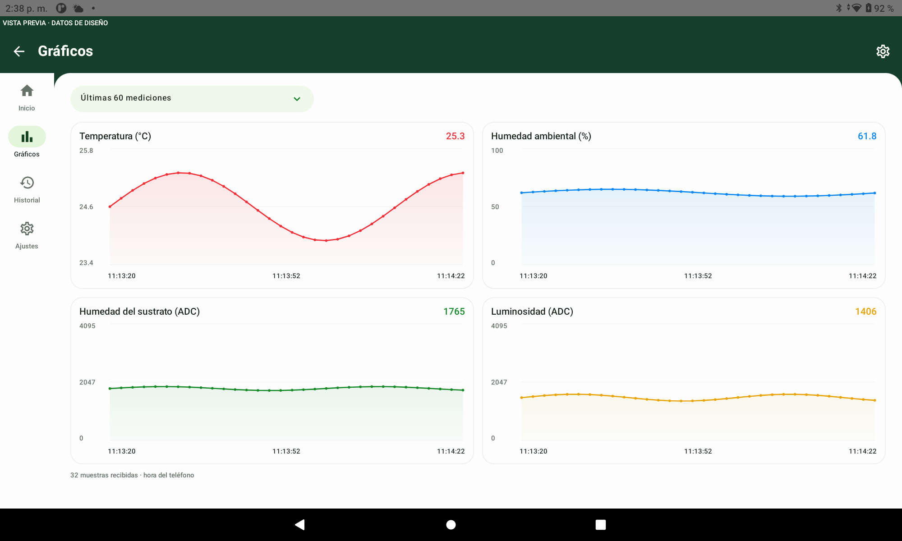
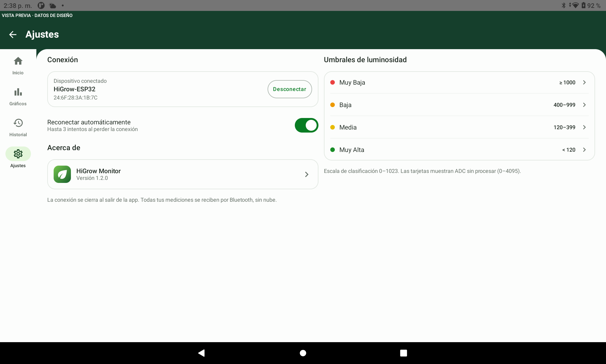
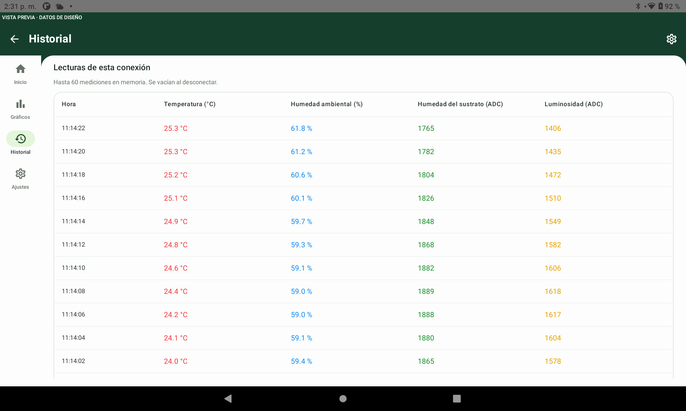
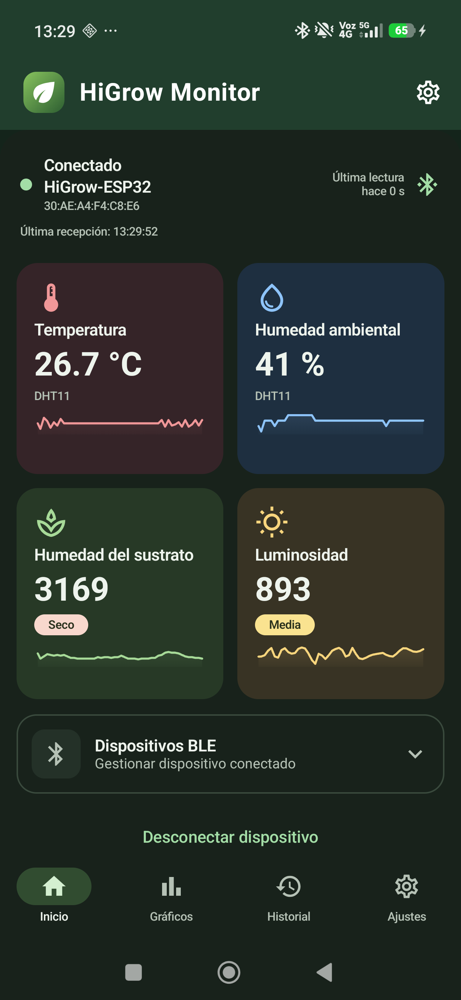
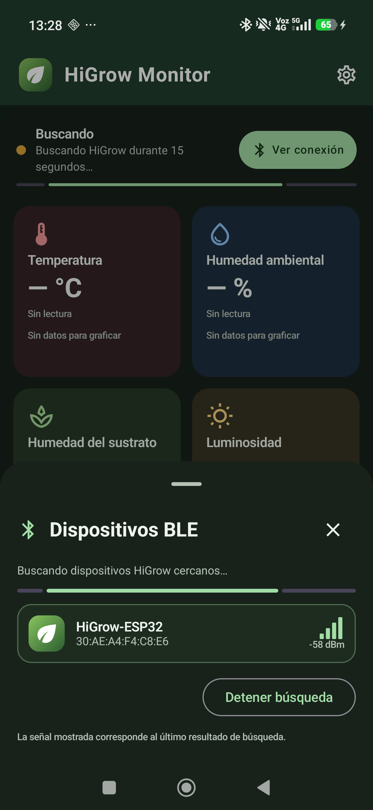
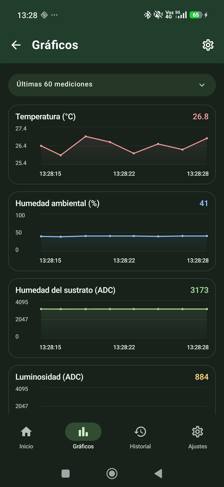
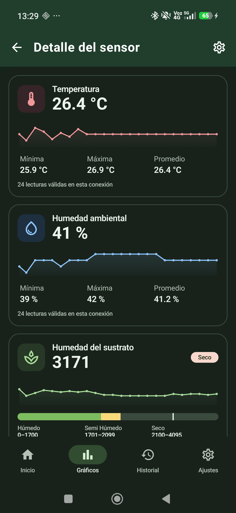
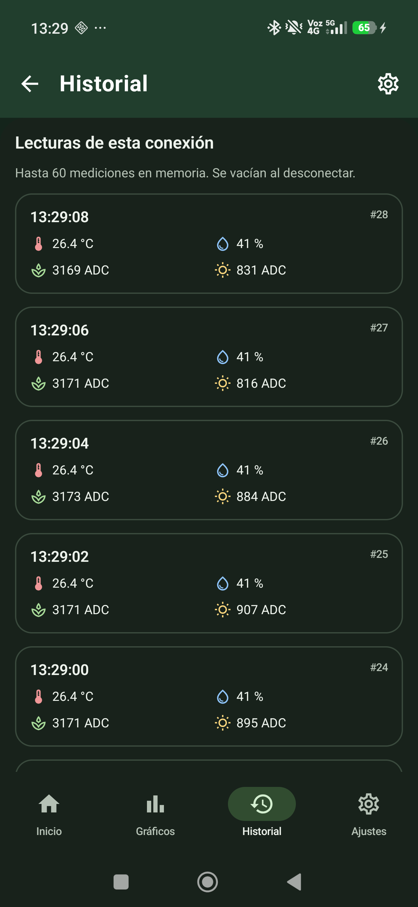
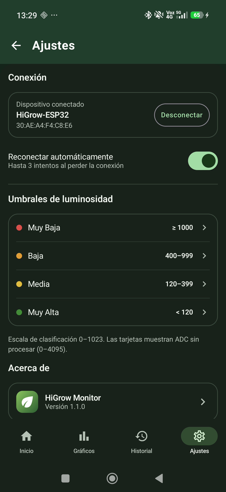

# HiGrow Monitor

Monitor local para **HiGrow ESP32 + Android 8.0 o posterior**, sin WiFi, Internet ni nube en funcionamiento. Firmware Arduino y cliente Android nativo Kotlin/Compose/Material 3. Esta carpeta es el proyecto que se abre en Android Studio.

## Tablet y ventanas amplias · versión 1.2.0

El diseño se adapta al espacio de la ventana: navegación lateral desde 600 dp, cuatro tarjetas de Inicio en una fila cuando caben, gráficos en una cuadrícula de 2 × 2 con altura ajustada a la pantalla, detalle y ajustes en dos columnas e historial en tabla cuando hay ancho suficiente. Al estrechar la ventana o aumentar el texto se reducen las columnas para mantener la legibilidad. En teléfonos estrechos se conserva la navegación inferior.

Estas capturas se obtuvieron ejecutando las **vistas de diseño en una Lenovo TB-J606F**, en horizontal. Llevan la etiqueta **VISTA PREVIA · DATOS DE DISEÑO**: sirven para revisar la distribución con muestras del editor y no representan una nueva sesión BLE real.

| Gráficos en horizontal | Ajustes en columnas | Historial en tabla |
| --- | --- | --- |
| <a href="docs/screenshots/tablet-graphs-landscape.png"></a> | <a href="docs/screenshots/tablet-settings-landscape.png"></a> | <a href="docs/screenshots/tablet-history-landscape.png"></a> |

También se puede consultar la [captura de Gráficos en vertical](docs/screenshots/tablet-graphs-portrait.png) y los [criterios de adaptación](docs/DESIGN.md#tablet-y-ventanas-redimensionables-120).

## Paneles de la app · versión 1.1.0

Inicio reúne las cuatro mediciones en tarjetas con minigráficas y estado de conexión. El selector BLE muestra los dispositivos compatibles cercanos; Gráficos permite revisar las últimas 15, 30 o 60 muestras. Al tocar un sensor se abre su detalle con mínima, máxima y promedio. Historial conserva hasta 60 paquetes de la conexión actual y Ajustes permite configurar la reconexión automática y los umbrales de luminosidad. Incluye modo claro/oscuro y adaptación a texto grande.

**Capturas reales de la app 1.1.0 en un Xiaomi 25069PTEBG**, en modo oscuro, conectado a un HiGrow-ESP32 el 22 de octubre de 2026. Las cifras proceden de los sensores por BLE; no son datos de demostración. Pulsa una imagen para verla a tamaño completo.

| Inicio conectado | Dispositivos BLE | Gráficos |
| --- | --- | --- |
| <a href="docs/screenshots/dashboard.png"></a> | <a href="docs/screenshots/ble-devices.png"></a> | <a href="docs/screenshots/graphs.png"></a> |

| Detalle del sensor | Historial | Ajustes |
| --- | --- | --- |
| <a href="docs/screenshots/sensor-detail.png"></a> | <a href="docs/screenshots/history.png"></a> | <a href="docs/screenshots/settings.png"></a> |

Consulta [el diseño y comportamiento de los paneles](docs/DESIGN.md).

## Puesta en marcha

1. Abre `firmware/HiGrowMonitor/HiGrowMonitor.ino` en Arduino IDE.
2. Instala **esp32 by Espressif Systems 3.3.12**, **DHT sensor library by Adafruit 1.4.6** y **Adafruit Unified Sensor 1.1.15** desde los gestores. Usa la biblioteca BLE **incluida en el core**, sin instalar ESP32 BLE Arduino por separado ni cambiar a las APIs de NimBLE o del core 4.
3. Selecciona **ESP32 Dev Module** (ESP32 original), Flash 4 MB, partición **Huge APP (3MB No OTA/1MB SPIFFS)**, puerto USB de tu placa; compila y carga. Monitor serie: **115200 baud**.
4. Abre esta carpeta en Android Studio que soporte AGP 8.13 (Otter 2025.2.1 o posterior compatible). Selecciona JDK 17 o 21 y sincroniza Gradle. El SDK Manager debe tener Android SDK Platform **35** y Build Tools **36.0.0**.
5. Ejecuta `app` en un **teléfono Android real con BLE**. En **Inicio**, pulsa **Conectar BLE**, concede los permisos, activa Bluetooth y selecciona `HiGrow-ESP32` en el panel **Dispositivos BLE**.
6. Las mediciones de **Inicio** se actualizan aproximadamente cada 2 segundos. Toca una tarjeta para ver su detalle; abre **Gráficos** o **Historial** desde la barra inferior. En **Ajustes** puedes editar los umbrales de luminosidad y activar/desactivar la reconexión automática. Las preferencias se guardan localmente.

Las descargas de herramientas/dependencias necesitan Internet al preparar la compilación. La aplicación no declara permiso de Internet y el ESP32 no inicia WiFi. La app usa únicamente datos recibidos de la placa. Las vistas previas de Android Studio incluyen muestras aisladas del editor y están identificadas como **DATOS DE DISEÑO**.

## Hardware

| Medición | Pin | Uso |
| --- | --- | --- |
| Sustrato integrado | GPIO32 | ADC de 12 bits, filtro cada 100 ms |
| DHT11 integrado | GPIO22 | Temperatura y humedad, cada 2000 ms |
| LDR externo | GPIO35 | ADC de 12 bits; salida analógica entre GND y 3.3 V |

Mantén GND común con el LDR. Se configura atenuación ADC de 11 dB explícitamente. Para el **HiGrow original** indicado por el usuario, `BoardConfig.h` activa la alimentación de sensores mediante **GPIO16 en LOW**, antes de iniciar el DHT11 del GPIO22. Otras revisiones (por ejemplo, LilyGO T-HiGrow) tienen un pinout diferente. Consulta [diagnóstico del DHT11](docs/DHT_TROUBLESHOOTING.md) antes de cambiar pines. No se aplica conversión a lux ni porcentaje de sustrato. El firmware mantiene BLE y lecturas continuas; no implementa deep sleep.

## Compilar desde terminal

Windows PowerShell, con JDK 17/21 y Android SDK configurados mediante `ANDROID_HOME` o `local.properties` (archivo local, no versionado):

```powershell
$env:JAVA_HOME = 'C:\Program Files\Android\Android Studio\jbr'
.\gradlew.bat testDebugUnitTest assembleDebug lintDebug
```

macOS/Linux: `./gradlew testDebugUnitTest assembleDebug lintDebug`. El wrapper completo está incluido; en Linux puede ser necesario `chmod +x gradlew`. APK: `app/build/outputs/apk/debug/app-debug.apk`. La firma debug es para desarrollo; la publicación requiere configurar una firma propia.

Arduino CLI (alternativa al IDE, con las dependencias anteriores):

```powershell
arduino-cli core update-index --additional-urls https://espressif.github.io/arduino-esp32/package_esp32_index.json
arduino-cli core install esp32:esp32@3.3.12 --additional-urls https://espressif.github.io/arduino-esp32/package_esp32_index.json
arduino-cli lib install 'DHT sensor library@1.4.6' 'Adafruit Unified Sensor@1.1.15'
arduino-cli compile --fqbn 'esp32:esp32:esp32:PartitionScheme=huge_app' firmware/HiGrowMonitor
arduino-cli upload --fqbn 'esp32:esp32:esp32:PartitionScheme=huge_app' --port COM5 firmware/HiGrowMonitor
```

Reemplaza COM5 por el puerto correcto. La carga se realiza de forma explícita; compilar no modifica la placa.

## Comportamiento y arquitectura

- `MainActivity`: permisos, solicitud de activar Bluetooth y ciclo de vida. La conexión sigue durante una rotación y se cierra al salir al segundo plano. Al regresar hay que conectar manualmente; no necesita servicio en primer plano.
- `BleManager`: escaneo con filtros por UUID o nombre, 15 s de límite, deduplicación, conexión GATT, descubrimiento, escritura CCCD y READ inicial. Las operaciones se serializan con `Handler` principal; se ignoran callbacks de sesiones cerradas. No solicita ampliar el MTU.
- `SensorRepository`: decodificación, último dato y hasta 60 paquetes válidos en memoria. Se vacían al desconectar para evitar presentar datos de otra sesión como actuales. Un paquete malformado se rechaza y se muestra el error sin refrescar la hora del último dato válido.
- `SensorViewModel`: `StateFlow`, estado combinado, reloj monotónico para antigüedad y preferencias de umbrales LDR. DHT inválido se representa con `null`; no se reutiliza el último valor válido. Un paquete con DHT inválido sigue aportando ADC reales.
- Compose: cabecera verde, tarjetas por sensor con minigráficas, selector BLE inferior y navegación **Inicio / Gráficos / Historial / Ajustes**. Incluye detalle con mínima/máxima/promedio, modo claro/oscuro y disposición en una columna con texto grande. Las gráficas interrumpen la línea del DHT en muestras inválidas; temperatura usa un eje ajustado a las lecturas y humedad/ADC mantienen el rango completo. Ver [diseño de los paneles](docs/DESIGN.md).

**Reconexión:** se puede activar o desactivar en Ajustes. Con la opción activada, ante fallo GATT o pérdida de enlace se libera el cliente y se realizan hasta tres intentos, con esperas de 2, 4 y 8 s y un máximo de 12 s por intento. El presupuesto no se restablece al reconectar: así se evita un bucle si el enlace se conecta y cae repetidamente. Se restablece al pulsar conectar manualmente. Desconectar, cancelar, apagar Bluetooth o salir de la app cancela los reintentos. La ausencia del servicio, característica o CCCD produce error sin reintentos automáticos.

**Datos desactualizados:** se avisa tras 6 s sin paquetes válidos, calculados con `elapsedRealtime()`. La hora visible es la del teléfono al recibir el paquete. El protocolo v1 no contiene contador ni reloj del ESP32: un READ indica la última muestra guardada, no su instante exacto de adquisición.

**Permisos:** Android 12+ usa `BLUETOOTH_SCAN` con `neverForLocation` y `BLUETOOTH_CONNECT`. Android 8–11 requiere `ACCESS_FINE_LOCATION` y Ubicación activada para escaneo nativo; el permiso está limitado con `maxSdkVersion=30`. No se pide ubicación en versiones posteriores. Si el usuario rechaza permanentemente un permiso, la pantalla explica cómo habilitarlo en Ajustes.

## Documentación y validación

- [Protocolo BLE y vector de prueba](docs/PROTOCOL.md)
- [Pruebas en nRF Connect y lista de comprobación física](docs/TESTING.md)
- [DHT11: alimentación, biblioteca y prueba sin BLE](docs/DHT_TROUBLESHOOTING.md)
- [Estado de las compilaciones en este equipo](docs/VALIDATION.md)
- Pruebas Android: `BlePacketParserTest.kt` y `MeasurementStatsTest.kt`, en `app/src/test/java/cl/higrow/monitor/data/`. Última validación: **13 pruebas correctas**, APK compilado y Lint con **0 errores**; detalles y límites en [VALIDATION.md](docs/VALIDATION.md).
- Prueba nativa del codificador/umbrales firmware: `tests/firmware_protocol_test.cpp`; en un equipo con C++: `g++ -std=c++11 tests/firmware_protocol_test.cpp -o protocol-test` y ejecutar el binario.

En Windows también puede ejecutarse desde **Developer PowerShell for Visual Studio**: `cl /EHsc tests/firmware_protocol_test.cpp /Fe:protocol-test.exe`, seguido de `.\protocol-test.exe`.

Versiones fijadas: AGP 8.13.2, Gradle 8.13, Kotlin/Compose compiler 2.2.20, Compose BOM 2025.08.01, Material Icons 1.7.8, Lifecycle 2.9.3, Activity 1.10.1, Core 1.16.0 y Coroutines 1.10.2. No se usan versiones dinámicas ni preliminares.

Referencias oficiales: [compatibilidad AGP 8.13](https://developer.android.com/build/releases/agp-8-13-0-release-notes), [BOM Compose](https://developer.android.com/develop/ui/compose/bom/bom-mapping), [permisos BLE](https://developer.android.com/develop/connectivity/bluetooth/bt-permissions), [callbacks GATT modernos](https://developer.android.com/reference/android/bluetooth/BluetoothGattCallback), [core ESP32 3.3.12](https://github.com/espressif/arduino-esp32/releases/tag/3.3.12), [DHT Adafruit](https://github.com/adafruit/DHT-sensor-library/releases/tag/1.4.6).
